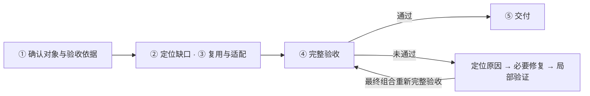

# CUDA → Ascend NPU 模型迁移

目标：保持目标模型的行为，在 NPU 上完成所需推理，并留下可复现的验证证据。先复用，再补真实缺口；达到验收条件就收敛。

**有修复义务、有停止依据、诚实交付，不承诺所有问题都能解决。**

> **发现问题就定位修复；局部修好后，最终组合仍须完整验收。平均分不能掩盖严重异常，未解决不能冒充完成。**

先看流程，再用表格查看每个环节要做什么、留下什么证据。只有全部必需验收项通过，才进入完成交付。

| 环节 | 具体做什么 | 留下什么证据 | 后续流向 |
| --- | --- | --- | --- |
| ① 确认对象与验收约定 | 获取模型、权重、配置和环境；确定基线、数据规模、指标与阈值 | 任务与环境记录；基线和阈值来源 | 定位实际缺口 |
| ② 定位适配缺口 | 用 CLUE 追实际路径，寻找共享能力；区分环境、配置、代码问题 | 适配点表：位置、问题证据、可复用实现、验证方式 | 处理已确认的缺口；已有能力足够则直接验证 |
| ③ 复用、修改、局部验证 | 优先配置和已有接口；必要时补局部实现；验证改变的行为 | 候选补丁；针对性测试结果 | 局部失败继续定位；局部通过进入验收 |
| ④ 量化验收 | 检查整体指标、失败请求、严重异常；最终组合运行完整精度与基础 benchmark | 实测值、阈值、失败/异常数、判定和日志 | 通过 → ⑤；未通过 → 修复循环；待验证 → 补证据或记录阻塞 |
| ↻ 未通过后的修复循环 | 从失败证据入手，做能区分原因的对照，必要修复并局部回归 | 原因及证据；修复前后结果；排除的假设 | 回到④完整复验；仍失败继续处理，确有停止依据则保留未完成状态 |
| ⑤ 验收通过后交付 | 每个模型经独立复核后交付代码与验收证据；沉淀新经验 | 最终补丁；迁移报告；独立复核结论；已验证的新案例 | 完成本模型，停止无关扩展 |

①—③是导航，可合并、交错或回退，但不能跳过第 2 节的用户方案确认点；不要求已有充分证据的工作重做。**④通向⑤有明确通过条件，修复循环不是“报告完问题就结束”。** 循环复用第 2—4 节的定位、修改和验证方法，不新增一套调试框架，也不固定工具、排查顺序、轮数或每轮必须改代码。未受影响的既有证据继续有效。

证据不足不能判为通过；确有阻塞或定位停滞时，按第 5 节保存现场并标明未完成。用户明确的范围和验收要求优先。

## 1. 确认模型、环境与基线

从当前任务、仓库和可用环境提取信息，不让用户重复填写已经能查到的内容：

- 对象：仓库与 commit、模型/权重版本、架构与规模、dtype/量化、真实启动入口。

- 目标：需要运行的功能、部署拓扑、输入与生成参数；不要由模型规模推断必须新增 TP。

- 环境：GPU/NPU 型号与可用设备、Python、PyTorch、torch_npu、CANN、框架版本；记录运行时实际导入的源码位置。

- 验收：默认真实权重推理、目标功能、项目精度评测、一组固定条件的基础 benchmark，以及按改动影响和项目要求确定的原平台回归。性能优化仅在有目标、明显退化或当前阻塞时展开。

**保留修改前状态：** 开始修改前记录基础 commit、已有未提交改动及其可恢复副本；无 Git 时保存相关原文件。保留本次迁移相对该状态的 diff，不覆盖用户原有工作。新模型出现故障时，对照修改前的行为与本次改动缩小原因；原始代码是定位依据，不因它是原版就视为必然正确，也不冒充已在 NPU 上实测的基线。

检查现有 GPU/NPU 状态：已实测、历史结果、当前失败、未运行。保留命令和证据。NPU 可用时先做小型设备操作和最小真实请求；明确的导入/配置阻塞先定位并写入方案；涉及适配代码或配置修改的，取得用户确认后再修，不必强行执行必败的完整评测。

优先复用兼容的现有环境、权重与评测。版本问题查目标环境对应的官方资料，不默认升级整套依赖。GPU 原实现也失败时，先区分基线故障与 NPU 差异；不以失败的 GPU 输出作为正确答案。

GPU 可用则尽量获取同协议基线。只有 NPU 资源时，主动查找官方或其他贡献者 PR 中的 GPU 精度结果，记录来源链接、代码和权重版本、数据集及评测条件，并注明这是外部报告，不是本次实测。引用的 GPU/CUDA 成绩仅用于与本次 NPU 修改后的实测结果对比；在报告、PR 或其他提交材料中，必须标明原作者与来源，不能将他人的成绩列为本次执行的测试或本次补丁的验证结果。GPU 未公开的逐样本记录填写“未提供”；仅缺少这些明细，不自动否定该基线。独立重算要求适用于本次 NPU 实测，外部 GPU 结果按公开资料核查。不要为获取基线强行开发整模型 CPU 路径。NPU 不可用时仍可定位、修改和运行适用的局部测试，但 NPU 验证保持待完成。

只有缺失信息会改变任务、无法自行查明或缺少执行资源时才提问；其余采用项目默认值并记录。模型、目标和环境足够明确后自主继续调研；方案经用户确认后，在已批准范围内自主实施，无需逐步等待提示。

**正确性依据：没有旧 NPU 补丁，也能检查是否做对。**

| 要判断什么 | 可以依据什么 |
|---|---|
| 输出内容是否正确 | 标准答案、输入原文和功能约束；例如 TTS 原文与音频转写比较 |
| 迁移是否降低整体能力 | 原始 GPU 实现、官方参考实现或协议一致的可信评测结果 |
| 内部环节是否算错 | 同输入下的独立局部实现、数学定义、算子和状态不变量 |
| 项目能否交付 | 事先确定的精度、失败与异常限额、功能要求及性能要求（如有） |

默认将 GPU/NPU 精度对比作为必需验收项。比较前核对模型与权重、dtype/量化、数据集与样本范围、输入和生成参数、评分方法。影响精度的条件不同或不明时，不能仅凭两个分数判断迁移是否达标；先补齐条件或使评测条件一致，仍无法比较则标为待验证。允许退化量沿用事先确定的验收标准。没有可比 GPU 基线时，不能自行改用 NPU 自测宣布完成；只有用户明确接受调整范围和绝对质量标准后，才能按新标准验收，且不能声称跨平台无退化。

**产出：** 在首次完整评测前记录任务范围及验收约定：数据集版本、固定清单与规模、评分器及预处理版本、基线来源、指标方向/单位、允许退化量、功能失败与严重异常限额、阈值来源。优先采用适用的用户/项目标准；官方成绩本身不是允许退化量。“完整”指约定范围，不是无限扩大测试。

无既定精度容差时，任何不利差异先触发核查，不自动判为回归或通过；查找适用标准，无法自行确定且影响验收时集中询问。门槛缺失保持待验证，不在看到成绩后自行放宽。功能请求失败、丢输出、非有限数值或串请求默认允许新增数为 0，已有明确要求优先；严重内容异常按模型定义，不套用统一 WER 阈值。

**固定验收依据：** 首次测试前记录数据集与标准答案、样本清单、验收配置/门槛和评测代码的版本及内容标识（已有不可变版本或文件哈希）。保留原始清单供交付复核；不得擅自改题、改答案、删难例、缩减范围或降低门槛。哈希用于发现变化，不代表不可篡改；有现成的只读数据源或独立验证入口时优先复用，不为本任务擅自修改系统权限。

开始修改模型适配代码前，按第 5 节复核验收约定。可使用 [报告模板](assets/migration-report-template.md)。指标计算或随机性影响判定时，按需读 [公式与随机性分析](references/acceptance-loop.md)。

## 2. 用 CLUE 找到适配缺口

- **C / 调用链：** 从实际启动入口沿配置、factory/builder、运行器走到执行和输出；同时看设备参数如何传递。

- **L / 已有分层：** 查平台接口、设备解析、算子/backend、数据处理、通信与评测的现有实现；读接口定义和一个相关调用者。

- **U / 目标范围：** 用模型名、架构名、注册项和目录缩小搜索；按调用关系扩展到共享依赖。

- **E / 错误线索：** 结合堆栈搜索 CUDA 假设，确认是否进入目标路径、是否已有替代分支。命中关键词不等于需要改动。

例如先用 rg 在相关范围查找：

~~~sh

rg -n 'current_platform|resolve_device|device_module|attention_backend' <相关目录>

rg -n 'torch\.cuda|\.cuda\(|is_cuda|nccl|CUDA_VISIBLE_DEVICES|sgl_kernel|flash_attn|flashinfer|triton|cuda_graph' <相关目录>

~~~

目录和关键词按项目调整；不要扫描权重、大型产物或要求清除所有 cuda 字样。

做 SGLang-Omni 迁移时按问题查阅 [案例](references/sglang-omni-casebook.md)，核对当前源码后再借鉴。

**产出：** 简短调用链和适配点表。每个点记录位置、失败或源码证据、已有能力、拟改动、验证方式。问题数由证据决定，零个或十个都可以。标记“待验证”的怀疑，不把它算成已确认缺口。

**先研究 GPU 路径，再提出 NPU 设计，用户确认后才实施。** 开始时先向用户说明这个顺序，然后只读追踪目标 GPU 配置从输入到输出的实际代码。

完成研究后，在一条方案回复中先说明本次任务要解决的问题、必须保留的功能与执行方式，再向不了解项目的读者讲清：GPU 各步骤做什么、为什么这样组织、关键代码在哪里；NPU 准备如何对应这些步骤、复用哪些已有能力、哪些地方必须不同及其原因。区分已查明的事实和未确定的判断；没有 GPU 实测时明确说明。

先用以下链路图讲清 GPU 实现和 NPU 大致方案，不能用类图替代链路图；优先用 Mermaid，无需另建绘图工具或文档：

- **GPU 实际链路图：** 从输入到输出，展开到本次迁移相关的具体实现作为叶子节点（例如后端、算子、缓存操作或图执行入口），在图中或相邻说明标出关键文件/函数。箭头说明调用或数据流向，不把整个框架无限展开；未查清的节点明确标注，不用猜测补全。
- **NPU 拟议方案图：** 尽量沿用 GPU 图的模块名称和展开层次，标明已有能力的复用、模型侧适配、实现替换，以及是否涉及框架或公共算子修改；必要差异说明原因和待验证事项。明确标为拟议方案，不冒充已实现或已验证的结果。
- **有实际备选方案时：** 分别画出关键差异，并比较适用条件、修改范围、风险和待验证事项，给出推荐理由；只有一个合理方案就只画一个，不凑数量。

本次 GPU 链路或 NPU 设计涉及类时，还须补充 UML 类图，说明相关类的职责、继承或组合关系及关键接口，并对应到链路中的步骤；只展开本次迁移涉及的类，不扩展成全框架类图。

**同一回复中说明已有测试的调研结果，而不是先自行制定测试计划。** 查阅目标模型的官方论文、官方 PR 或其他贡献者 PR 及其关联评测代码，分别说明它们怎样测精度和吞吐：使用的数据与范围、指标和评分方法、主要运行条件（如硬件、并发、预热及计时口径），附来源。对照本次根本需求，说明哪些测试适用、是否建议采用同样的测试，以及哪些要求未被覆盖或哪些条件无法复现，供用户判断；不能因他人采用就直接当作本次验收标准。资料未说明或未找到的内容标明未知，不猜测补齐，也不把外部成绩当成本次实测。

回复末尾请用户确认具体方案、修改范围及采用哪些参考测试，并等待明确答复；确认前可以继续只读调查，但不修改适配代码或配置。用户提出调整时，修订方案后再确认。涉及框架或公共算子的修改，仍须满足原有具体范围审批要求。

## 3. 复用、修改、局部验证

**未经用户明确批准扩大范围，只允许修改目标模型代码及其专属配置和测试；不得修改框架或公共算子实现。** 可以调用已有接口和算子，但不能以修复或优化为由自行改变其实现。 修改前记录目标模型目录，以及本次调用链涉及的框架共享代码路径（`protected_paths`），例如调度器、平台层和公共算子。清单用于检查修改范围；未列出的框架共享代码仍受同样限制。在项目已声明支持的范围内选择 NPU 环境、依赖版本或已有后端，不属于框架修改；改写框架源码、替换共享函数或改变项目依赖约束，属于框架修改，无论改动放在模型目录还是已安装依赖中。

模型侧方案无法完成所需功能，或完整评测仍未达到约定的精度、异常或性能要求时，先根据失败证据做有针对性的定位。若已有证据指向框架限制，或合理的模型侧尝试已无法提供新的定位信息，应向用户汇报并讨论下一步，不无限重复模型侧试错。只验证有合理可能的模型侧方案，不要求穷尽方案或制造绕过实现；错误出现在框架调用链中、精度落后或尝试停滞，都不能单独证明框架修改是必需的。NPU 吞吐或延迟不必与 GPU 相同；若可比条件下的差距值得关注，应报告实测差距、比较条件和可能原因，与用户讨论是否需要优化或扩大修改范围，不能因追赶 GPU 性能自行改框架或公共算子。未约定性能门槛时，不自行增设门槛。

汇报说明：模型侧已经做到什么、哪些验收项仍未通过、尝试及结果、为什么考虑修改框架、拟改文件和行为、影响范围与验证计划，以及尚未证实的判断。由独立审查代理核查修改理由和范围，再与用户讨论。**框架修改取得用户对具体范围的明确批准后才能实施，不能先改后问；“完成迁移”不等于批准修改框架。** 已有明确覆盖该范围的批准不重复申请，扩大范围须补充批准。等待期间继续不依赖该修改的工作。

**获批后，将框架补丁与模型补丁分开，提交 PR 时优先分别提交。** NPU 专属行为使用项目已有的 NPU 判断或按实际设备选择实现，避免影响 CUDA/CPU；通用错误不必强行加 `is_npu()`。交付前检查本次所有改动，包括新增文件、已安装依赖和依赖版本，确认没有未经批准的框架修改。接手旧版 skill 的迁移结果时也要检查，但不能擅自撤销用户已有改动。

对每个确认的缺口，优先考虑现有配置/接口、同仓库已适配实现、直接依赖提供的后端或通用 API。只有这些不能保持所需语义时才补局部实现或扩展已有抽象。NPU 设计应以已研究的 GPU 路径为依据，尽量沿用相同的功能划分和模块组织，复用已有公共流程；硬件差异集中在必要的实现处。不要求 API 或代码逐行相同，也不为形式对齐复制整条流程、重排无关代码或扩大修改范围。

每项非平凡修改回答：原行为是什么？哪里不兼容？复用谁？如何证明修复？在适配点表中简短记录即可。下表是常见缺口的处理示例，按实际问题选用，不要求逐行执行。

| 缺口 | 优先处理 | 有针对性的验证 |
|---|---|---|
| 设备默认值、索引、factory 参数 | 使用共享 resolver/builder，保持显式配置与调度器注入的优先级 | 默认值、非零逻辑索引、显式设备；mock 符合真实接口 |
| CUDA API、导入、kernel/backend | 复用平台或依赖提供的实现；设备已知时按实际设备派发 | 目标路径能导入和运行，原 CUDA 分支仍可达 |
| layout、dtype、attention、KV cache | 在负责该语义的组件最小修复 | 针对实际 shape、mask、cache 写入/读取范围和数值检查；涉及 kernel 时需真实硬件验证 |
| graph、compile、通信、预后处理 | 查既有能力与共享处理路径，按已验证的目标环境选择 | 实际执行路径及所需流式/并发/参考输入；不能只检查配置字段 |

平台事实归平台，共享不变量留公共层，模型算法问题留模型层；不为局部问题创建通用框架。更少的代码行不是硬目标。

**修复必须保留需要迁移的功能和执行方式，不能靠绕过故障通过验收。** 开始时将目标 GPU 路径中的图执行等所需能力纳入验收；不能自行将其改成可选项。不得为了跑通而关闭所需的 graph/compile、把应在 NPU 上的模型计算转到 CPU，或跳过出错阶段。原有 CPU 预后处理不受此限制。临时关闭图执行或使用 CPU 对照只能用于定位，不能作为完成证据；交付前须恢复目标执行方式并验证，确实无法支持则汇报未完成项，不能自行降级。NPU eager 仍是 NPU 计算，但也不能替代所需的图执行。全局 CUDA→NPU 替换仅在项目本身采用且语义适合时考虑；不因迁移而新增 TP、量化或自定义 kernel。

复用已有测试并补充改变了的行为边界；无需为每个文本替换新增测试。局部通过后继续真实推理。新失败先看首个有效错误，区分环境、数据、框架与模型原因，再修一个可解释的问题。去掉已被替代的临时路径及失去用途的测试。

**产出：** 最终代码/配置差异，更新后的适配点及局部测试证据。

## 4. 量化验收；不通过就修复再验收

**批量任务不降低单模型标准。** 开始时列出全部目标模型及各自必需验收项；环境准备、工具和公共修复可以共享，但每个模型必须独立完成约定的功能、完整精度、基础 benchmark 和第 5 节独立复核。少量兼容矩阵或某个模型通过不能代替其余模型验收。资源、额度或时间不足就分批，未完成模型明确保留状态，不自动缩减测试。共享依赖后来改变时，逐个确认受影响模型并按最终组合复验。

按第 1 节的验收约定执行。复用项目的启动、请求、评测和 benchmark；确实没有入口时才补最小验证代码。

- **真实运行：** 真实权重最小请求和目标功能，包括约定的并发/流式/参考输入。启动、HTTP 200、mock 通过不能代替内容正确。

- **精度：** 同权重、同数据、同输入条件和评分协议，记录基线、候选、差值与门槛。生成模型不要求逐 token 或音频字节一致；算子容差按 dtype 和语义确定。完整验收必须覆盖约定样本，不以排障小样本替代。

- **基础 benchmark：** 固定预热、样本量、并发和计时边界，报告吞吐、平均/尾延迟及目标相关指标。有性能门槛时一并判定；没有时只报告测量，不承诺性能达标。

- **相关回归：** 开始时按改动影响和项目要求确定范围，后续改动扩大时重新核对。独立审查确认原平台执行路径未改变、且项目未要求原平台实测的，不因缺少 GPU 阻塞 NPU 交付；改动影响原平台或项目明确要求的验证仍须完成，缺少资源就记录阻塞。未执行不能写成通过，历史 GPU 精度也不能证明本次补丁的 CUDA 回归。

每个必需验收项写明“通过 / 未通过 / 待验证”、实测值、阈值和证据。严格检查整体指标、失败请求和严重异常样本。任何一项未通过，或出现崩溃、串请求、乱码等内容异常，都进入问题处理；缺少可比数据、有效阈值或运行资源则是待验证。平均值改善不能抵消另一必需项失败。

**问题处理闭环：完整评测发现问题 → 最小实验定位 → 必要修复 → 局部验证 → 最终组合完整复验。**

| 环节 | 应执行什么 |
|---|---|
| 发现问题 | 检查整体指标、失败请求和严重异常；保留逐样本输出、评分、成功/失败/缺失/跳过数及原因，不能让失败从分母消失 |
| 定位原因 | 保留失败输入与运行条件，复现问题；核对原始输出和评分，优先对照本次 diff 与修改前行为，必要时用保留现场的局部回退或同输入实验验证。diff 只是线索，不是根因边界；证据不支持时，沿调用链检查未修改的代码、共享依赖、环境或评测，用最小对照缩小原因 |
| 修改代码 | 针对有证据的原因，复用现有能力做必要修复；实验性修改验证后才能保留，不能仅凭分数更低认定根因成立 |
| 局部验证 | 检查原故障及同类场景，确认改变的行为；无效实验改动及时撤回，修好几条样本不等于整体修好 |
| 整体验收 | 最终代码、关键依赖和配置重新运行完整精度、基础 benchmark 及受影响功能回归；出现新故障或验收不达标则继续处理 |

排查阶段使用小规模实验，不要求每次改动都跑全量。涉及流式或中间状态时，区分当前输出与供后续步骤使用的状态，核对请求归属、顺序和生命周期；按证据选检查，不要求每次追帧或穷尽硬件细节。

每轮在同一报告简记失败项及数值、假设、对照、结论、改动和复验结果。假设排除就换方向；不得靠删难例、换有利种子、挑最好一轮、放宽门槛或改变原定任务配置过关。评分修复按下述规则处理，保留原协议结果。

**保护测试与结果：** 捕获异常可以让其他样本继续执行，但必须把该样本记为失败并纳入计数；不得捕获异常后返回成功、移除有效断言、无理由 skip/xfail，或用默认/伪造结果通过。每次运行保存独立的命令、版本、逐样本输出与日志，不覆盖旧失败证据；退出码 0 不是验收通过的充分条件。评测器确需修复时，与模型修复分开记录，保留原协议和原始输出，由独立代理检查考核含义是否改变。若改变评分方法，须对双方完整原始输出统一重算，或取得同一新评分方法下的可信 GPU 结果，才能判定精度差异；外部 GPU 无原始输出且无新基线时，该比较保持待验证。已确认有问题的旧评分结果仅供追溯，不能作为通过依据。改变标准答案、范围或门槛须经用户明确接受。

可自行处理的失败继续解决，不能以“原因已分析”或“历史 PR 也存在”结束。历史故障仍按本次验收要求处理，不自动豁免；未经证实的差异不能直接叫迁移回归或随机波动。

最终验收绑定具体代码/diff、依赖、配置和日志。影响推理结果、数值、调度或关键推理依赖的最后一次修改后，用最终组合重跑约定的完整精度集、基础 benchmark 和受影响功能回归；不得用旧版本全量加新版本小样本拼成最终通过。仅评分修改按上述评分修复规则处理；仅文档修改无需重跑。其他未受影响且版本对应的证据继续有效。

**产出：** 同一报告中的验收判定、问题处理记录、最终补丁对应的复验证据。多个模型分别报告，任一模型完成验收及独立复核即可单独交付。

## 5. 交付并保留新经验

**只有最终版本的全部必需验收项和独立审查都通过，才能宣布“可交付”。任何必需项失败、未执行或证据不足，都必须在报告和最终回复开头明确“不可交付”并列出缺口，不能先宣布完成，再在末尾否认。可以提交阶段成果，但不能把阶段成果称为迁移完成。**

| 状态或情况 | 应采取的动作 |
|---|---|
| 验收通过 | 有充分证据满足事先约定的精度、功能、失败与异常要求，基础 benchmark 已完成，有性能门槛时也须满足，且独立复核通过；交付并停止无关扩展 |
| 验收未通过，仍有可执行的定位或修复 | 继续第 4 节闭环，不以问题报告代替处理 |
| 必要资源、权限、数据或参考缺失 | 保存现场，说明具体所需条件；受影响项目保持未通过或待验证 |
| 定位停滞 | 先回顾已试假设和对照有效性；仍无可执行且能区分原因的下一项实验时，请求针对性协助，标为尚未解决 |
| 达到用户预算或用户要求阶段交付 | 提交已有工作并明确未完成范围；缩小目标须由用户明确接受，再对调整后的范围验收 |

**由未参与该模型实现和测试修改的子代理独立审查。** 审查代理不编写修复代码，可以复用，无需全程跟随。

固定审查两次：修改模型适配代码前，检查验收约定是否覆盖用户原始需求；每个模型交付前，检查最终代码和运行证据是否满足这些要求。准备修改框架或变更评测规则时，再审查相应变更。只读定位、常规环境准备和基线检查可以先做。

提供用户原始需求及已接受的变更、验收约定，以及当时已有的代码、测试和运行记录，不能只提供执行者的总结。审查否决必须指出未满足的原始要求或事先约定的验收项，并提供证据；额外改进建议单列，不能自行变成交付门槛。明显违反原始功能要求的缺陷，不能因验收表未列出该具体故障而放过。

交付前按下表复核；前期和变更审查只检查当前决定所需的项目，不要求尚未产生的最终运行证据。

| 复核对象 | 独立代理必须核实 |
|---|---|
| 原始目标与修改范围 | 对照原始需求检查功能、精度、部署和性能要求是否遗漏，以及框架修改是否获批。核查实际执行设备和所需 graph/compile 等路径，不能只看配置或输出正确；定位时的 CPU 对照、关闭图执行或跳过阶段不能冒充修复 |
| 验收依据 | 对照测试前版本/内容标识，检查数据、答案、清单、配置和门槛有无未经接受的改变 |
| 测试真实性 | 阅读实际执行的评测入口与相关修改，检查异常是否被当作成功、断言是否绕过、失败是否被跳过；必要时用一个失败输入验证失败路径 |
| 结果完整性 | 将约定样本 ID 与实际记录核对，检查缺失/重复与全部失败；从本次 NPU 逐样本原始记录独立重算关键计数和指标，不能只复述汇总分数 |
| 最终版本与内容 | 核对结果对应最终代码、依赖和配置，检查严重异常及修复证据；按疑点重放必要样本，不能以抽查代替执行者的完整验收 |
| GPU 对比与测试有效性 | 核查 GPU 来源、比较条件、NPU 实测和验收阈值。检查现有测试能否发现关键功能缺失或失败；已有对应最终版本的测试证据可以复用，不足时再补针对性验证，且不得改坏正式验收数据 |

记录审查时机、代理标识、实际检查的证据、发现和结论。发现问题后，由执行者修复，并说明问题为什么发生、原检查为什么没有发现；保留能发现原问题的测试或检查证据，再由审查代理复核。未查清的原因明确写“未知”，不能编造解释。执行者不能自行宣布审查通过；审查无法执行或必要证据缺失时，仍不可交付。独立复核不默认重复全部推理，也不等于安全隔离；相同写权限下的代理不能保证数据不可被篡改。

一个假设失败不构成停止依据，也不无限重复没有新信息的实验。**尚未解决不等于无法解决。** 认定上游缺陷或模型局限需要可复现证据；不能自行豁免严重故障或降低标准。

交付最终代码/配置和一份 [迁移报告](assets/migration-report-template.md)，说明修改原因、最终版本对应的完整结果、失败及严重异常数、benchmark、复现命令和日志。多个模型分别判定、分别报告，任一模型完整验收且独立复核通过后即可单独交付；用户未要求的能力不构成阻塞，必需但未验证的能力不能算完成。

若暂停，还须留下失败输入、当前代码及依赖、实际影响与指标、已试对照及结论、保留/撤回的改动，以及下一实验或所需协助。不能只写“建议继续排查”。

有新经验时先放报告末尾：触发条件、症状、根因、复用/修复、验证、版本边界。未经验证的想法标为假设。已有项目知识库且任务允许维护时，合并有证据的新案例并去重；否则报告即为候选记录，不自动改动已安装 skill。

维护本 skill、做历史回放或陌生模型试跑时，再读 [试跑说明](references/skill-trials.md)；日常模型迁移不需要执行 skill 评估。

